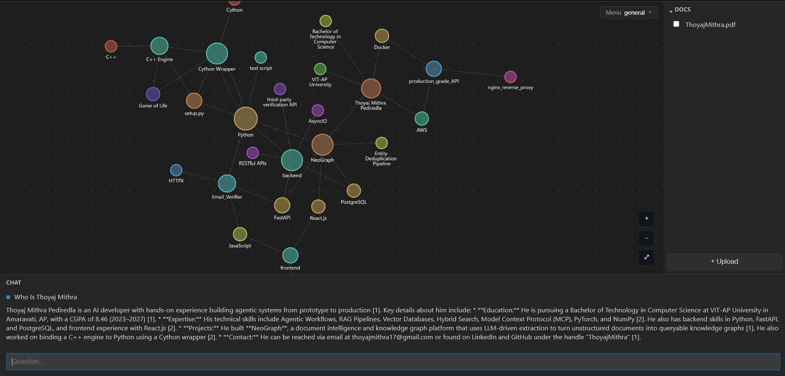
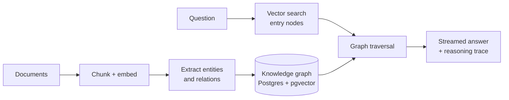

# neograph

A chat app that builds a knowledge graph as you talk to it, and lets you see that graph.

You chat in the browser. The backend stores what it learns as nodes and edges in Postgres, and the reasoner uses that graph when it answers. A separate view draws the graph so you can look at what it actually knows.




## Why neograph

Plain RAG chops documents into chunks and hopes the right ones come back. That falls apart when the answer depends on how things *connect*: who worked with whom, which concept depends on which, what led to what.

neograph builds the connections first. It reads your documents, extracts entities and the relationships between them, and stores everything as a graph. When you ask a question, the agent finds the relevant starting points and walks the graph to gather context, so answers come from connected evidence instead of isolated paragraphs.

## What you get

**Documents in, graph out**
Upload files and an LLM pipeline extracts entities and relations. Embedding-based deduplication merges repeat mentions, so the same entity across many chunks becomes one node.

**Questions answered from the graph**
A Graph RAG agent uses vector search to find entry nodes, traverses the graph from there, collects the supporting chunks, and streams the answer back.

**Answers you can check**
Every answer has a reasoning trace. The graph viewer highlights the exact nodes and edges the agent used, so you can see where an answer came from instead of taking it on faith.

**Conversation-aware**
The agent uses chat history, so follow-up questions work the way you'd expect.

**One workspace**
Chat, document sidebar and a live force-directed graph, side by side.

## How it works



Full component diagram: [diagram.md](diagram.md)

## Built with

| Layer | Tech |
| ----- | ---- |
| API | FastAPI, async psycopg |
| Storage | Postgres + pgvector |
| Embeddings | Cloudflare |
| Frontend | React, Cytoscape.js (fcose layout) |
| Tooling | uv, Docker, GitHub Actions |

## Quick start

```bash
git clone https://github.com/ThoyajMithra/neograph.git
cd neograph
cp .env.example .env      # add your keys
docker compose up
```

Prefer running it locally?

```bash
# backend
uv sync
uvicorn app.api.app:app --reload

# frontend
cd app/web
npm install
npm run dev
```

Requires Postgres with the `vector` extension.

## Project structure

```
app/
  api/          FastAPI app, routes, dependency wiring
  web/          React frontend (chat, sidebar, graph viewer)
engine/
  ingestion/    files -> chunks -> graph
  extraction/   LLM entity and relation extraction
  embedding/    embedding encoder
  graph/        knowledge graph + traversal
  agent/        async Graph RAG reasoner
  models/       nodes, edges, documents
storage/
  postgres/     document, chat, graph and vector stores
```

The `engine/` package has no dependency on the web app, so the graph and agent logic can be used on their own.

## Roadmap

- [ ] Graph analytics views
- [ ] Multi-user support
- [ ] More document formats

## Author

Built by [Thoyaj Mithra](https://github.com/ThoyajMithra)